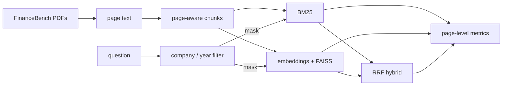

# finance-rag-eval

[](https://github.com/bharathkumardev1/finance-rag-eval/actions/workflows/ci.yml)


Retrieval benchmark for RAG over SEC filings, built on the open
[FinanceBench](https://github.com/patronus-ai/financebench) sample: 150 analyst questions over
360 10-K, 10-Q, 8-K, and earnings filings. Every FinanceBench question comes with the page that
answers it, so retrieval can be scored at the page level instead of by reading generated
answers.

On these filings, knowing which filing to search mattered a lot more than the choice of
retriever. A company/year filter read from the question roughly doubled page-level Hit@10.

## Quick start

```bash
git clone https://github.com/bharathkumardev1/finance-rag-eval
cd finance-rag-eval
pip install -e ".[dev]"

finrag download   # 360 PDFs, about 670 MB
finrag pages      # page text, cached under data/pages
finrag verify     # checks the labeled evidence pages line up with the extracted text
make bench        # retrieval grid + ANN comparison + results/RESULTS.md
```

The grid takes about 7.5 minutes on 2 CPUs and the ANN comparison about 1.5. `verify` should
print `match=189` with nothing off by one; if it doesn't, page numbering is off and every
metric after it is wrong.

```
$ finrag bench --config configs/default.yaml
...
1024/0/bm25/none                 hit@10=0.207 mrr@10=0.089 p50=0.5ms
1024/0/dense/none                hit@10=0.093 mrr@10=0.031 p50=18.7ms
1024/0/hybrid/none               hit@10=0.153 mrr@10=0.059 p50=18.7ms
1024/0/bm25/company              hit@10=0.240 mrr@10=0.110 p50=0.5ms
1024/0/dense/company             hit@10=0.180 mrr@10=0.068 p50=19.2ms
1024/0/hybrid/company            hit@10=0.213 mrr@10=0.100 p50=17.2ms
1024/0/bm25/company_year         hit@10=0.453 mrr@10=0.211 p50=0.6ms
1024/0/dense/company_year        hit@10=0.400 mrr@10=0.162 p50=18.4ms
1024/0/hybrid/company_year       hit@10=0.440 mrr@10=0.208 p50=18.3ms
```

## Results

Numbers below are from [`results/benchmark.json`](results/benchmark.json) at commit `616cd1e`.
The full grid (4 chunkings × 3 retrievers × 3 filters) is in
[`results/RESULTS.md`](results/RESULTS.md).

Hit@10 at 1,024-word chunks:

| Filter | BM25 | Dense (LSA) | Hybrid | Right filing in top 10 (BM25) |
|---|---|---|---|---|
| none | 0.207 | 0.093 | 0.153 | 0.500 |
| company | 0.240 | 0.180 | 0.213 | 0.760 |
| company + year | 0.453 | 0.400 | 0.440 | 0.933 |

Things worth knowing:

- Without a filter the right filing is in the top 10 only half the time. Filings from
  different companies share a lot of vocabulary ("capital expenditures", "operating income"),
  which makes it easy for both BM25 and embeddings to land on the wrong filing.
- The filter recognized a company in 147 of 150 questions, kept the gold filing for 148, and
  cut the candidates from 360 filings to 9.8 on average. It only reads the question text,
  never the labels.
- With the filter on, the problem moves to finding the page: right filing 93% of the time,
  right page 45%. Turnover-ratio questions are a good example. 5 of the 6 miss, because the
  inputs sit in a balance sheet and an income statement that share almost no words with
  "fixed asset turnover ratio".
- BM25 has a higher MRR@10 than the LSA dense baseline in all 12 chunk/filter combinations.
  With the filter on, their Hit@10 is within noise.
- Bigger chunks helped: 0.333 / 0.367 / 0.453 Hit@10 at 256 / 512 / 1,024 words (BM25,
  filtered). A 128-word overlap at 512 did nothing (0.360 vs 0.367).
- 150 questions is not many. One question is 0.0067, and the 95% interval around 0.45 is
  about ±0.08, so I wouldn't read much into gaps of a few points.

### Exact vs approximate search

53,461 vectors (512-word chunks, 256-dim LSA), one thread, median of 5 runs per query:

| Index | Setting | Recall vs exact top 10 | p50 ms | p95 ms | Build s | Size MB |
|---|---|---|---|---|---|---|
| Flat | exact | 1.000 | 4.620 | 5.506 | 0.03 | 54.7 |
| HNSW (M=32) | efSearch=64 | 0.881 | 0.067 | 0.121 | 15.3 | 69.3 |
| HNSW (M=32) | efSearch=256 | 0.969 | 0.285 | 0.398 | 15.3 | 69.3 |
| IVF (nlist=924) | nprobe=16 | 0.935 | 0.073 | 0.127 | 2.76 | 56.1 |
| IVF (nlist=924) | nprobe=64 | 0.988 | 0.194 | 0.245 | 2.76 | 56.1 |

At this size exact search is already under 5 ms, so the index type isn't the bottleneck. Dense
latency in the grid is 18 to 59 ms p50, and most of that is encoding the query with TF-IDF + SVD
over a large vocabulary. Filtered dense search, which only scores a few hundred rows, is still
18 to 49 ms.

## How it works



- `chunking.py`: word windows that keep track of which pages they cover. A chunk counts as a hit
  only if it's from the right filing and covers an evidence page.
- `filters.py`: matches company names, a small ticker/nickname table, and years in the question.
  Falls back to all of the company's filings if the year matches nothing, and to no filter if no
  company is found.
- `retrievers.py`: `bm25s` for BM25, FAISS inner product for dense, reciprocal rank fusion
  (k=60, depth 100) for hybrid. Filtered dense search is exact over the allowed rows.
- `metrics.py`: Hit@k, Recall@k over evidence pages, MRR@10, and doc hit@k (right filing, any
  page).
- `store.py`: an incremental FAISS index keyed by each document's SHA-256. Upserting an unchanged
  filing is a no-op; a changed filing has its old chunks removed and new ones added.
- `gate.py` + `configs/gate.json`: CI runs the whole pipeline on a tiny synthetic corpus and fails
  if a tracked metric drops below its baseline.

## Config

`configs/default.yaml` drives the full run:

| Key | What it does |
|---|---|
| `embedder` | `lsa-256` (default, offline), `hashing-N`, `st:<sentence-transformers model>`, or `openai:<model>` |
| `chunkings` | list of `[words, overlap]` pairs |
| `methods` | any of `bm25`, `dense`, `hybrid` |
| `filters` | any of `none`, `company`, `company_year` |
| `hybrid_depth` | how many results from each retriever go into RRF |
| `company_aliases` | extra names and tickers per company |
| `ann.*` | chunking, HNSW `M` / `efSearch`, IVF `nprobe` values for `finrag ann` |

LSA is the default so everything runs offline and gives the same numbers every time. To try a
real embedding model:

```bash
pip install -e ".[st]"
# configs/default.yaml -> embedder: st:BAAI/bge-small-en-v1.5
make bench
```

or `pip install -e ".[openai]"`, set `OPENAI_API_KEY`, and use
`embedder: openai:text-embedding-3-small`.

`pip install pymupdf` makes `finrag pages` much faster. It's optional because it's AGPL.

## Tests

```bash
make test   # ruff + pytest (16 tests)
make gate   # fixture benchmark + quality gate, same as CI
```

CI runs both on Python 3.10 and 3.12. The fixture corpus in `tests/fixtures/mini` is made up
(three fake companies, two years each) and only exists so the pipeline can run in CI in a few
seconds.

## Caveats

- The dense numbers above are LSA, not a transformer embedder.
- Relevance is page-level. A chunk that covers the evidence page counts even if the full answer
  needs a second statement.
- The nickname part of the alias table (AMEX, JnJ, JPM, MGM) was added after seeing which
  questions use those names. It only changes whether the filter recognizes the company.
- Retrieval only. Nothing here scores the generated answers yet.

## TODO

- [ ] Rerun with `bge-small-en-v1.5` and `text-embedding-3-small`
- [ ] Cross-encoder reranking over the filtered candidates
- [ ] Table-aware chunking for financial statements
- [ ] Answer-level eval with an LLM judge (faithfulness, correctness)

## Data

FinanceBench is from Patronus AI. The filings and questions aren't redistributed here;
`finrag download` pulls them from the FinanceBench repo.

> Islam, P., Kannappan, A., Kiela, D., Qian, R., Scherrer, N., and Vidgen, B. (2023).
> FinanceBench: A New Benchmark for Financial Question Answering. arXiv:2311.11944.

## License

MIT
