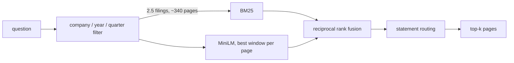

# finance-rag-eval

Retrieval over SEC filings, measured one page at a time. [FinanceBench](https://github.com/patronus-ai/financebench)
has 150 analyst questions over 360 10-K, 10-Q, 8-K and earnings filings (53,399 pages),
and each question is labeled with the page that answers it. I held out 100 questions and
tuned on the other 50.

On the held-out questions, BM25 over every page puts the answer page in its top 10 for
14 of 100. Reading the company and period out of the question, searching only those
filings, and sending questions about a balance sheet, income statement or cash flow figure
to those statement pages first gets that to **73 of 100** with the hybrid retriever I
picked on the dev split, and **75 with BM25 alone**. That difference is noise, and BM25
answers in 1.8 ms where the hybrid takes 16 ms, so the embedding model isn't paying for
itself here. The same pipeline runs in the browser on
[bharathkumardev1.github.io](https://bharathkumardev1.github.io), with identical rankings.

```bash
pip install -e ".[dev]"
make data embed eval     # 670 MB download, about 2.5 h of embedding on 2 cores, 1 min of eval
```

## Results

100 held-out questions; Hit@10 means an answer page is in the top 10. Intervals are 95%,
from 10,000 bootstrap resamples over questions. Latency is in-process, one thread, on an
Intel Xeon at 2.1 GHz. Everything here comes from [`results/eval.json`](results/eval.json)
(commit `f04dd24`); [`results/RESULTS.md`](results/RESULTS.md) has every configuration on
both splits.

| Each row adds one step to the row above | Hit@1 | Hit@10 | 95% CI | MRR@10 | p50 |
|---|---|---|---|---|---|
| BM25 over all 53,399 pages | 0.07 | 0.14 | 0.08–0.21 | 0.091 | 1.0 ms |
| Only filings from the company the question names | 0.07 | 0.17 | 0.10–0.25 | 0.100 | 2.2 ms |
| Only that company's filings for the year asked about | 0.09 | 0.41 | 0.32–0.51 | 0.155 | 1.9 ms |
| Narrowed to the quarter's filing when a quarter is asked about | 0.09 | 0.43 | 0.34–0.53 | 0.158 | 1.8 ms |
| Company name left out of the BM25 query | 0.12 | 0.33 | 0.24–0.42 | 0.183 | 1.7 ms |
| **Statement questions sent to statement pages first** | **0.43** | **0.75** | 0.66–0.83 | **0.534** | 1.8 ms |
| Same, with MiniLM instead of BM25 | 0.43 | 0.71 | 0.62–0.80 | 0.527 | 14.4 ms |
| Same, BM25 and MiniLM fused (the dev pick) | 0.45 | 0.73 | 0.64–0.82 | 0.542 | 16.1 ms |

What each step is worth, as paired differences on the same 100 questions:

- **The filter: +0.29 Hit@10** (0.20 to 0.38). Without it, BM25's top 10 includes a page
  from the right filing only 42% of the time, because filings from different companies
  share most of their vocabulary. The filter reads company names, four nicknames (AMEX,
  JnJ, JPM, MGM) and years from the question, and narrows 360 filings to 2.5 on average.
  It recognized the company in 97 of 100 questions; the other 3 never name one.
- **Statement routing: +0.42 Hit@10** (0.32 to 0.52), the biggest single step. 96 of the
  168 labeled pages are a balance sheet, income statement or cash flow statement. Those
  pages are tables. They share almost no words with "what is the FY2019 fixed asset
  turnover ratio", so BM25 usually ranks them well outside the top 10. A question that
  names a statement, or a line item or ratio that lives on one (working capital, capex,
  effective tax rate), gets those pages first. 62 of the 100 test questions trigger it.
  For metrics questions, the full pipeline goes from 0.00 Hit@10 (BM25, no filter) to 0.94.
- **Dropping the company's name from the query: +0.04** (−0.02 to +0.10), the step I'm
  least sure of. On its own it hurt (0.43 to 0.33): the name is one of the few words a
  statement page shares with the question, so it was quietly doing the router's job. Once
  routing handles statement pages it helps narrative questions, where the name mostly
  matches boilerplate. Within noise either way.
- **Adding MiniLM (the hybrid row): −0.02** against the BM25 pipeline (−0.08 to +0.03),
  with MRR +0.008. MiniLM alone, without the filter, is a real gain over BM25 alone (+0.10,
  0.01 to 0.19) because it finds the right filing more often (61% against 42%). Once the
  filter picks the filing, BM25 catches up. On the 50 dev questions the hybrid looked 0.12
  better, which is why it's the configuration I committed to before looking at the test
  split; with 50 questions that gap was noise.

By question type, the full hybrid pipeline gets 0.94 Hit@10 on metrics questions, 0.73 on
domain questions and 0.53 on the "novel" questions that annotators wrote for each specific
filing. Those are the hardest, because the answer often sits in a narrative paragraph that
shares few words with the question.

## Where it still misses

Every held-out question without an answer page in the top 10 is sorted into the first
pipeline stage that lost it. The rules are in [`failures.py`](src/finrag/failures.py)
and run on every evaluation, so these counts move when the code does.

| 27 of 100 held-out questions missed by the hybrid pipeline | Questions |
|---|---|
| The answer page shares at most two words with the question | 12 |
| No year in the question, and pages from other years' filings won | 4 |
| The answer page shares words with the question, but other pages share more | 4 |
| The question never names the company | 3 |
| Needed a statement page, but nothing in the question said so ("capital-intensive") | 2 |
| The filter kept the wrong filing (FY2023 guidance that lives in the Q4 2022 earnings release) | 1 |
| Right kind of statement, but another statement page ranked first | 1 |

The first row is where I'd go next. Those are narrative pages, and they need either a
reranker that reads the question and the page together or query expansion with the
filing's own terms. A cross-encoder over the top 50 filtered pages is the experiment I
haven't run.

## How it works



- [`filters.py`](src/finrag/filters.py) matches company names from the filing metadata
  plus [`configs/aliases.yaml`](configs/aliases.yaml), then years ("FY21", "fiscal 2022"),
  then quarters ("2022 Q2", "Q2 of FY2023", "second fiscal quarter of 2023"). Each step
  falls back to the previous one if nothing matches. The four aliases are the ones dev
  questions needed; each is commented with the question that motivated it.
- [`bm25.py`](src/finrag/bm25.py) is BM25 written out (Lucene variant, k1=1.5, b=0.75) so
  the browser port can match it exactly. A test checks its scores against bm25s.
- [`dense.py`](src/finrag/dense.py) runs sentence-transformers/all-MiniLM-L6-v2 through
  ONNX Runtime with no PyTorch. The model file is pinned by SHA-256 to the official
  upload. Pages are split into 254-token windows (171,158 of them) and a page scores as
  its best window. CI checks the embeddings against sentence-transformers itself.
- [`statements.py`](src/finrag/statements.py) has two small pattern sets: one finds the
  statement title at the top of a page (skipping indexes, auditor reports and notes, and
  pages that aren't mostly numbers), the other reads which statement a question needs.
- [`evaluate.py`](src/finrag/evaluate.py) has the metrics, the stratified dev/test split
  ([`configs/split.json`](configs/split.json), drawn by hashing question ids), bootstrap
  intervals and paired comparisons.

## What I tried and didn't keep

| Alternative | What happened | Decision |
|---|---|---|
| Ranking word chunks instead of pages (the first version of this repo) | A 1,024-word chunk spans two or three pages, so "top 10 chunks" is closer to "top 25 pages" and flatters the numbers. | Pages: they're what the labels mark and what a citation shows. |
| LSA (TF-IDF + SVD) as the dense baseline (also the first version) | Lost to BM25 on MRR in every setting. | Replaced with MiniLM. |
| HNSW instead of exact search | Exact search over all 171,158 windows takes 24 ms p50; HNSW takes 0.7 ms (efSearch 64) and returns 92.5% of the exact top 10 pages, or 1.4 ms and 98.9% at efSearch 256. But after the filter, exact search over the ~340 candidate pages takes 0.27 ms. HNSW costs a 97 s build and 44 MB more memory (295 MB against 251 MB). | Exact search. Only the 3% of questions with no company would benefit. |
| int8 dynamic quantization of the query encoder | 2.8× faster (4.5 ms against 12.3 ms p50), 4× smaller (22 MB). Cosine with the fp32 vectors averages 0.960. Test Hit@10 0.69 against 0.71, MRR 0.545 against 0.527: within noise. | Worth taking if the dense path stays. Pages stay fp32. |
| Keeping the hybrid as the shipped retriever | Ties BM25 on test, 9× the latency, 3.5× less throughput, and 250 MB of vectors. | BM25 is the default I'd ship; hybrid stays available for questions without a company. |

The [`scripts/alternatives.py`](scripts/alternatives.py) run that produced these is in
[`results/alternatives.json`](results/alternatives.json).

## As a service

```bash
finrag serve                                    # or: docker build -t finrag . && docker run ...
curl "localhost:8000/search?q=What+was+3M%27s+FY2018+capital+expenditure%3F&method=bm25&k=3"
```

`GET /search` returns the filings the filter picked, which statements it routed to, and
the top pages with snippets. `GET /healthz` reports what's loaded, and `GET /metrics`
exports Prometheus counters for requests by method and status, a latency histogram, and
two quality signals: queries where the filter found no company, and queries routed to
statements.

Load test ([`scripts/loadtest.sh`](scripts/loadtest.sh)): one uvicorn worker pinned to one
CPU, the load generator pinned to the other, closed-loop clients cycling through the 150
questions for 20 s per level. Zero errors at every level.

| Retriever | Clients | Requests/s | p50 | p95 | p99 | Server memory |
|---|---|---|---|---|---|---|
| BM25 | 1 | 146 | 6.5 ms | 10.1 ms | 12.9 ms | 948 MB |
| BM25 | 4 | 160 | 23.7 ms | 41.3 ms | 53.2 ms | 952 MB |
| BM25 | 32 | 170 | 180 ms | 302 ms | 364 ms | 975 MB |
| Hybrid | 1 | 41 | 22.0 ms | 41.5 ms | 59.4 ms | 979 MB |
| Hybrid | 4 | 45 | 81.1 ms | 152 ms | 191 ms | 1,026 MB |
| Hybrid | 16 | 48 | 324 ms | 492 ms | 648 ms | 1,158 MB |

One core saturates at about 170 BM25 requests a second; past that, more clients only add
queueing. In-process BM25 is 1.8 ms, so most of the 6.5 ms is HTTP, JSON and snippets.
At c5.large on-demand pricing ($0.085 an hour for 2 vCPUs, us-east-1, October 2026),
compute comes to about **$0.07 per million BM25 queries** and $0.24 per million hybrid
queries at peak throughput, before memory headroom, idle capacity or a load balancer. That
treats one vCPU here as one c5 vCPU; a c5 core is faster than this 2.1 GHz one. The
service keeps the whole corpus in memory (about 950 MB, which leaves room for two workers
on a 4 GB c5.large).

What I'd alert on in production: p95 latency, 5xx rate, the share of queries where the
filter finds no company (a rising share means users are asking about companies or
nicknames the alias table doesn't know), and the share routed to statements (a sudden drop
means the question patterns changed).

## Browser demo

[`web/finrag.mjs`](web/finrag.mjs) is the filter, BM25 and routing in JavaScript.
`finrag export-demo` writes the 84 filings the questions cite as gzipped JSON (14.5 MB in
all, loaded one filing at a time), each with the corpus-wide IDF of its terms, so browser
scores equal Python's. The parity test in [`web/test`](web/test) checks 438
question-and-setting pairs covering 146 of the 150 questions: same top 10 pages in the
same order, and float32 scores that match exactly.

## Run it

```bash
pip install -e ".[dev]"   # Python 3.11+
make data                 # download 360 PDFs (670 MB), extract pages with PyMuPDF, check labels
make embed                # MiniLM over every page: about 2.5 h on 2 cores, resumable
make eval                 # every configuration: about a minute
make alternatives         # optional: int8 and HNSW measurements, needs faiss-cpu
make loadtest             # optional: Linux only (uses taskset)
finrag ask "What was 3M's FY2018 capital expenditure?"
```

`finrag verify` checks that every labeled page lines up with the extracted text (it
should print `match=189` with nothing off by one). Page text comes from PyMuPDF 2.0,
pinned in `pyproject.toml`, because a different extractor changes every number downstream.

## Tests and CI

- 29 pytest tests: BM25 against bm25s, the filter's names, years and quarters,
  statement detection on real page shapes, routing order, MaxP scoring, hybrid fusion,
  metrics, the bootstrap, the split, the failure categories, the service's errors and
  metrics, incremental embedding after an interrupted write, and MiniLM against recorded
  vectors.
- A synthetic fixture corpus (three invented companies, statement pages, a 10-Q) runs the
  whole evaluation in CI, and [`configs/gate.json`](configs/gate.json) fails the build if
  the full pipeline loses a single fixture question.
- CI also re-exports the fixture and runs the JS parity tests, downloads the real MiniLM
  from Hugging Face and compares against sentence-transformers, and builds the Docker
  image and queries it.

## What's still rough

- 100 test questions. One question is 0.01 Hit@10, and the intervals above are about ±0.09.
- I read the dev questions while writing the aliases and statement patterns, and an
  earlier version of this repo had looked at all 150 questions. The four aliases also cover
  every test question that uses a nickname, so the test numbers would be the same either
  way, but the split isn't pristine.
- Labels mark one page. Some misses have another page that answers the question just as
  well (Corning's tax rate is in both MD&A and the tax note); those count as misses.
- No reranker and no generation. This stops at retrieval.

## Data

FinanceBench is from Patronus AI. The filings and questions aren't redistributed in this
repo; `finrag download` pulls them from the FinanceBench repository. The browser demo
serves page text of 84 public SEC filings.

> Islam, P., Kannappan, A., Kiela, D., Qian, R., Scherrer, N., and Vidgen, B. (2023).
> FinanceBench: A New Benchmark for Financial Question Answering. arXiv:2311.11944.

## License

MIT
